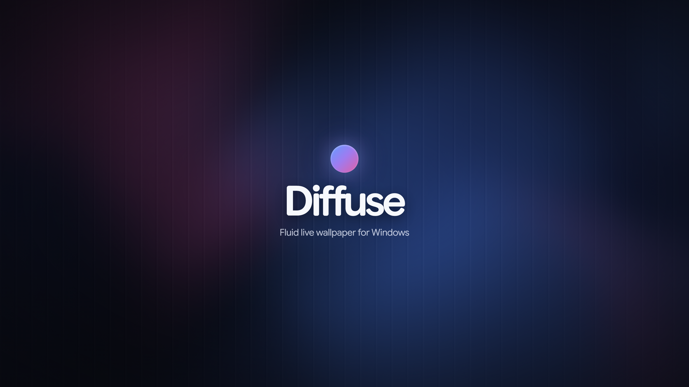
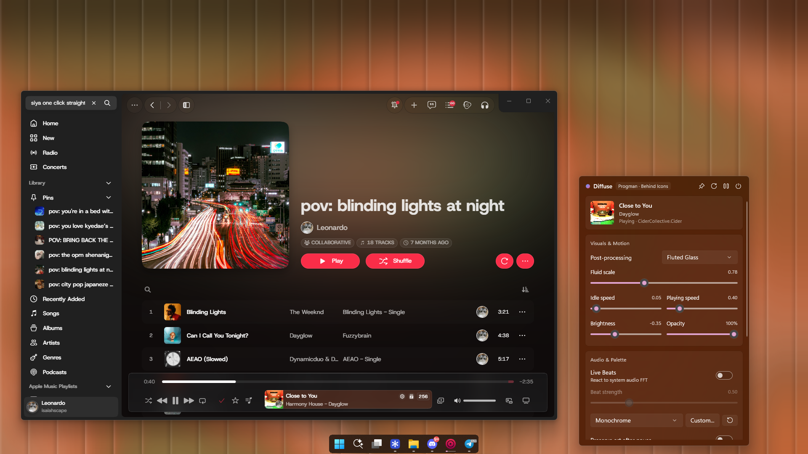
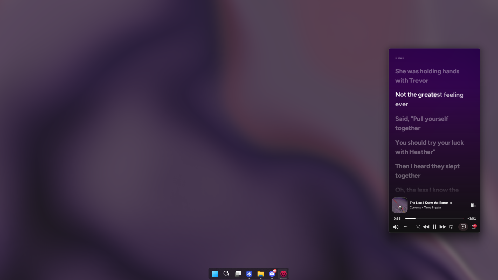
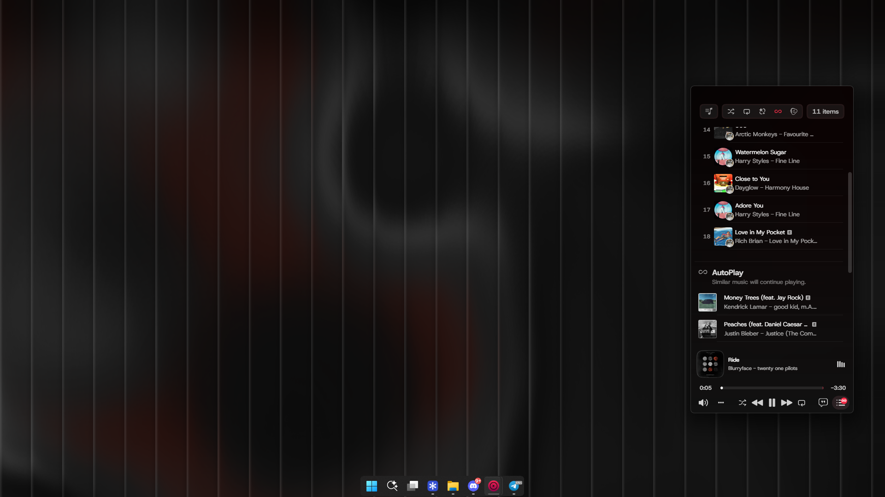

<p align="center">
  
</p>

<h1 align="center">Diffuse for Windows</h1>

<p align="center">
  <a href="https://github.com/isaiahscape/windiffuse/actions/workflows/windows-installer.yml">
    
  </a>
  <a href="https://github.com/isaiahscape/windiffuse/releases">
    
  </a>
  <a href="https://github.com/isaiahscape/windiffuse/commits/main">
    
  </a>
  <a href="https://ko-fi.com/isaiahscape">
    
  </a>
</p>

<p align="center">
  Live Wallpaper that shows what you are playing in a fluid-motion manner. A Native Windows 11 port of <strong>Diffuse for Android</strong> featuring a <strong>WinUI 3</strong> floating system-tray flyout + installer.
</p>

---

## Features

- **WinUI 3 Floating Tray Flyout:**
  - Floats in the system tray with smooth Windows 11 open/close slide-and-fade animations and  Desktop Acrylic Backdrop .
  - Left-click the tray icon to toggle controls; right-click for quick actions.
- **Desktop Layering:**
  - Supports **Windows 11 24H2 / 25H2 / 26H2** raised-desktop parenting plus classic fallback.
  - Configurable **Wallpaper Opacity**, **Span all monitors**, **Pause on fullscreen app**, and **Start with Windows**.
- **Direct3D 11 & DirectComposition Pipeline:**
  - Ports Diffuse's multi-pass shader pipeline, and configurable **FPS limit / VSync**.
- **Windows Now Playing (SMTC) & Live Beats (WASAPI):**
  - Reads album art and playback state from Cider, Spotify, Apple Music, YouTube Music, VLC, etc., with optional 4-band WASAPI loopback FFT beat reactivity.

### Screenshots

<p align="center">
  
</p>

| Blur | Fluted Glass |
| :---: | :---: |
|  |  |

## Install / Build & Run

Download the latest `DiffuseSetup-<hash>-win-x64.exe` or portable `.zip` from [Releases](https://github.com/isaiahscape/windiffuse/releases), or build locally:

```powershell
.\build.ps1
.\run.ps1
```

Build the self-contained WinUI 3 installer and portable zip:

```powershell
.\installer\build-installer.ps1
```

Options:
- `.\run.ps1 -ShowUi` — Open the floating WinUI 3 flyout immediately on launch.
- `.\run.ps1 -Preview` — Run in a preview window instead of attaching behind desktop icons.

Settings and logs are stored in `%AppData%\DiffuseWindows\`.

## Credits

- **[JustZht](https://github.com/JustinFincher)** (**Depthware** / **[FinGameWorks](https://github.com/FinGameWorks)**) — Creator of the original **Diffuse** Android live wallpaper, fluid shader design, and palettes.
- **[rocksdanister](https://github.com/rocksdanister)** (**[Lively Wallpaper](https://github.com/lively-community/lively)**) — Windows live wallpaper reference for `Progman` / `WorkerW` desktop parenting and Windows 11 raised-desktop techniques.
